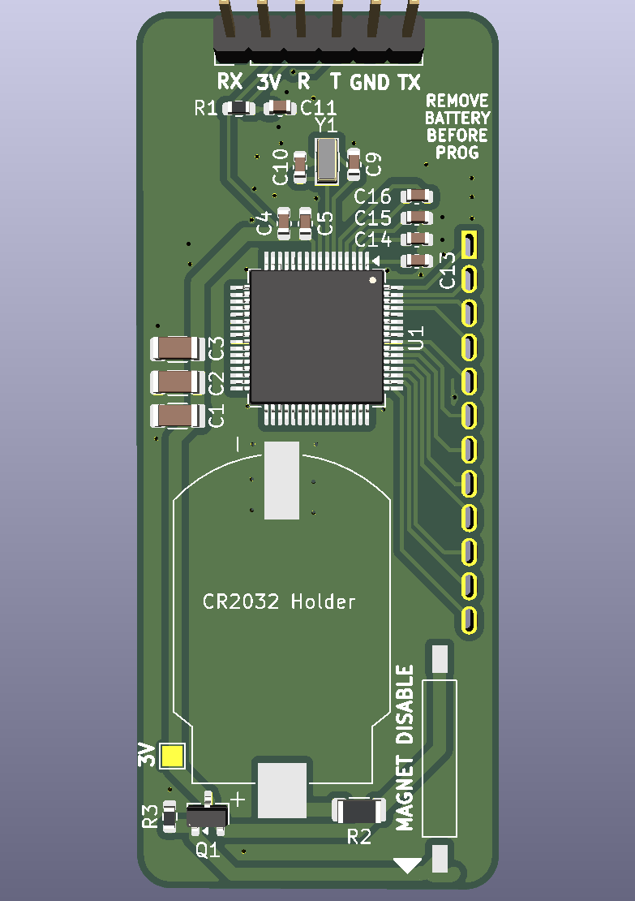
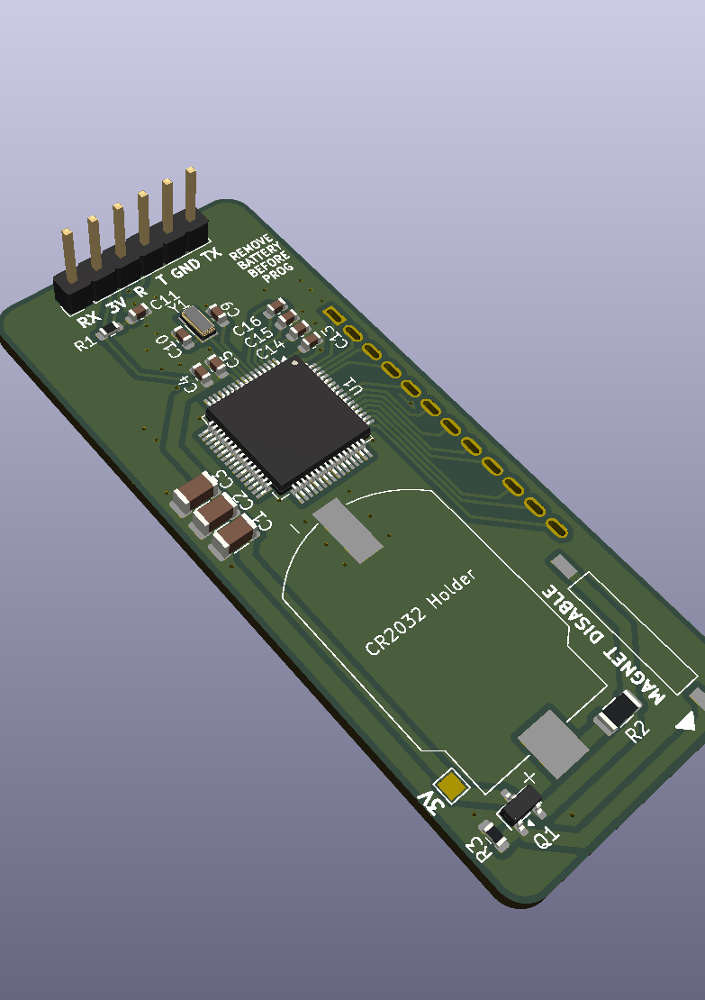

# ocn-LCD

A coin-cell elapsed-time counter with a 4-digit LCD and a magnetic off switch. While a magnet
sits at the marked end, the board is switched off. Take the magnet away and it powers up and counts
elapsed time in hours and minutes, up to 99:59 (about 100 hours). Put the magnet back and it powers
down a few seconds later; the next time the magnet comes off, counting starts again from 00:00.

The renders leave out the LCD (on the back), the coin-cell holder and the reed switch, which have no
3D models.

Status: revision 0.1, not yet built. Firmware will be added to this repository.

## How it works

- **Counting.** An MSP430FR4131 drives the LCD directly with its built-in LCD controller and keeps
  time from a 32.768 kHz crystal. It spends almost all its time in its deepest sleep mode with the
  display still running, so it should draw 1–2 µA while counting (see the power budget below).
- **Magnet switch.** The magnet closes a normally open reed switch (SW1). That pulls the gate of a
  P-channel MOSFET (Q1) up to the cell voltage and cuts power to everything after it. With the
  magnet away, a 10 MΩ resistor pulls the gate low and the board runs. While switched off, the only
  drain on the cell is that resistor, about 0.3 µA.
- **Reset on purpose, not by accident.** 14 µF of capacitance after the switch keeps the board
  running for several seconds after the magnet arrives, so a brief knock or switch bounce does not
  reset the count. Leaving the magnet in place longer than that powers the board down and clears it.
- **Display.** The LCD is a Good Display GDC04212: 4 digits with a colon, 1/4 duty, 3 V. It mounts
  on the back of the board, so the front carries every surface-mount part.

## Power budget

Estimates at 3.0 V and 25 °C, from the TI datasheet (SLAS865) and the part specs. They will be
replaced by measurements once the firmware is in.

| Item | Counting (magnet away) | Off (magnet in place) | Basis |
|---|---|---|---|
| MCU asleep (LPM3.5), with the 32 kHz crystal, RTC, LCD controller and charge pump running | 0.94 µA | 0 | Datasheet typical, supervisor (SVS) off |
| LCD glass: recharging the segments about 30 times a second | 0.2–1 µA | 0 | Estimate from typical TN glass capacitance (~2 nF); the biggest unknown |
| Waking once a minute to advance the count and rewrite the display | ~0.01 µA | 0 | ~2 ms at ~0.4 mA per wake; waking every second instead would cost ~0.8 µA |
| Colon blink | ~0 | 0 | Done by the LCD hardware, no CPU wake |
| Gate pull-down R3 (10 MΩ across the cell while the reed is closed) | 0 | 0.3 µA | 3.0 V / 10 MΩ |
| Q1 MOSFET leakage while off | – | a few nA | Typical; the datasheet maximum is specified at 30 V |
| Hold-up capacitors C1–C3, leakage | ~1 nA | 0 | MLCC insulation resistance; under 0.1 µA even at the spec minimum |
| Reset pull-up, reed switch, unused pins (driven low) | 0 | 0 | No DC path |
| **Total** | **about 1.2–2 µA** | **about 0.3 µA** | |

Estimated runtime on one CR2032 (225 mAh nominal), allowing about 1 %/year for the cell's own
self-discharge:

| Mode | Estimated runtime |
|---|---|
| Counting continuously | about 11–18 years |
| Off (magnet in place) | over 40 years |

Both are longer than a CR2032's rated shelf life of about 10 years, so in practice the cell's age
sets the limit, not this circuit. Cold reduces the cell's usable capacity, so expect less in cold
conditions.

Firmware choices that keep it there:
- Leave the voltage supervisor (SVS) off in LPM3.5; it costs about 0.2 µA. The brownout reset stays
  on regardless.
- Update the count once a minute, not once a second.
- Blink the colon with the LCD hardware, not by waking the CPU.
- Drive every unused pin low, including the RX pin when nothing is connected to it.

## Placing the magnet

The reed switch is at the end marked MAGNET DISABLE and runs along the length of the board. It
responds to field along its own length, so use a magnet magnetized through its flat faces (a
neodymium cylinder or disc), at that end, with its axis along the board and its face toward the
board's end. SW1's axis is 4.4 mm in from the long edge that carries the LCD pins, and a magnet
centered on that line gives the most margin.

A magnet centered on the board's width sits about 9 mm off SW1's axis and puts roughly half to a
quarter as much field along it. Even so, a model of a typical 10 × 8 mm N42 cylinder (no nearby
steel) gives several times the switch's ~2–3 mT pull-in out to about 20 mm. Check the actual magnet
on the bench, especially if steel sits near it.

The switch lets go only once the magnet is a few centimeters away (the same model puts it at about
35–40 mm in line), so move the magnet well clear to start counting.

## Key parts

| Ref | Part | LCSC |
|---|---|---|
| U1 | TI MSP430FR4131IPM, LQFP-64 (FR4132/FR4133 also fit) | C1879660 |
| DS1 | Good Display GDC04212 4-digit LCD, 12 pins at 2.54 mm | none (hand-soldered) |
| BT1 | Lian Xin BS-CR2032-8 coin-cell holder, for a CR2032 | C7498149 |
| SW1 | Littelfuse 59170-1-S-00-D reed switch, normally open, 10–15 AT | C315909 |
| Q1 | AO3401A P-channel MOSFET, SOT-23 | C15127 |
| Y1 | 32.768 kHz crystal, 3215, 12.5 pF | C32346 |

Every part in the BOM carries its LCSC number. The LCD, J1 and TP3 are left out of the BOM and the
placement file. The passives are 0603 and 1206.

## Assembly

1. **Surface-mount parts first, all on the front.** A stencil helps with the 0.5 mm pitch MCU. The
   holder and the reed switch are rated for reflow, so a hotplate works.
2. **LCD last, by hand.** The LCD is through-hole on the back. Solder it after reflow and keep the
   iron off the glass. The silkscreen marks its pin 1.
3. **Programming header (J1).** It is only needed on the bench.
4. **Battery.** Fit the CR2032 after programming.

## Programming

The MCU is programmed over Spy-Bi-Wire from the eZ-FET programmer on a TI MSP-EXP430FR4133
LaunchPad. Any MSP430 LaunchPad with an eZ-FET should also work. J1 carries the four programming
signals plus the MCU's serial port.

1. **Take the coin cell out.** The LaunchPad powers the board at 3.3 V, and with a cell fitted it
   would push current back into it. The board's silkscreen says so too.
2. **Pull every jumper off the LaunchPad's J101 isolation block.** That disconnects the
   LaunchPad's own MCU, so the eZ-FET talks only to this board.
3. **Wire J1 to J101 with dupont jumpers.** Use the J101 pins on the eZ-FET (emulator) side, not the
   side that runs to the LaunchPad's own MCU:

   | ocn-LCD J1 | LaunchPad J101, eZ-FET side |
   |---|---|
   | 3V | 3V3 |
   | R | SBW RST |
   | T | SBW TST |
   | GND | GND |
   | RX (optional, serial) | RXD |
   | TX (optional, serial) | TXD |

   The serial names match straight across. J101 labels its pins from the target MCU's point of
   view, so its RXD carries data into this board's RX.

4. **Flash the firmware** with TI UniFlash or Code Composer Studio. Select the MSP430FR4131 and the
   LaunchPad's eZ-FET as the connection. A command-line recipe will come with the firmware.
5. **Unplug the LaunchPad before measuring current or fitting the cell.** The programming and
   serial lines draw current of their own.

**Measuring battery current.** R2 (1 Ω, 1206) sits in series with the cell. Lift it and connect a
current meter across its pads. TP3 is a test pad on the switched 3 V supply.

## Files

- `ocn-LCD.kicad_pro`, `.kicad_sch` and `.kicad_pcb`: the KiCad 10 project. The board is 27 × 65.4 mm,
  two layers.
- `lib/`: the board's own symbols and footprints: the MSP430FR413x, the GDC04212 and its footprint,
  the coin-cell holder and the reed switch. The project's library tables point at this folder, so the
  project opens without any other library installed.

## License

Licensed under the **CERN Open Hardware Licence Version 2 – Permissive**
(CERN-OHL-P v2). See [LICENSE](LICENSE) and [NOTICE](NOTICE).

You may make, modify, and sell boards from these files, with no obligation to
publish your changes.
