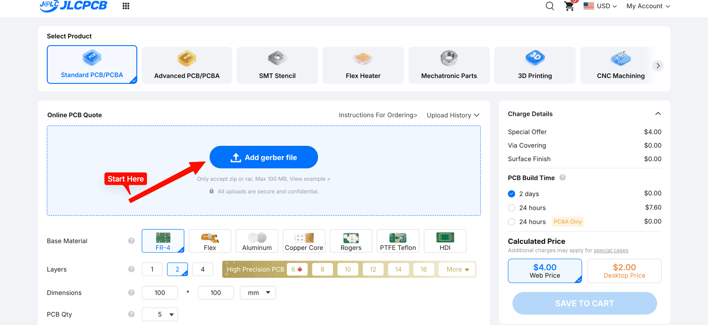
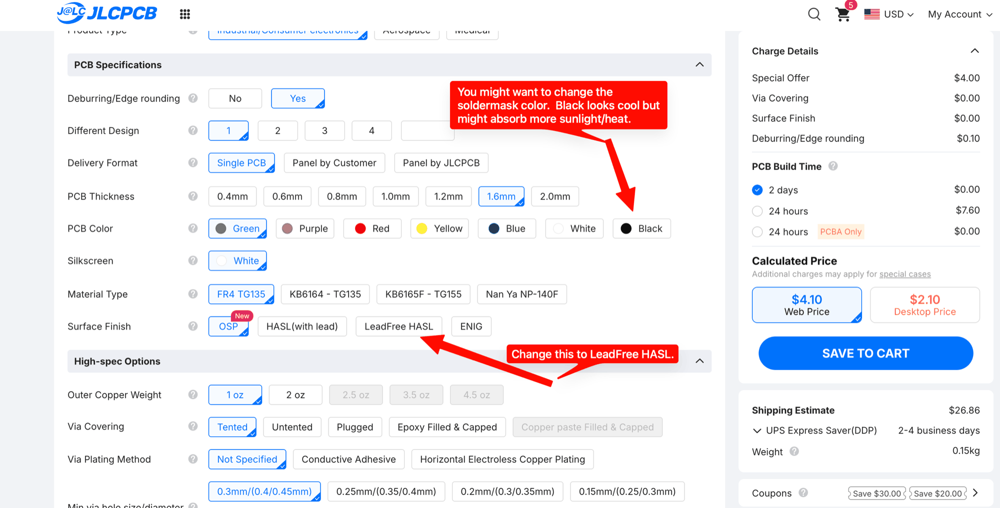
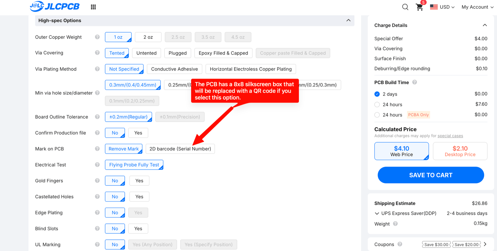
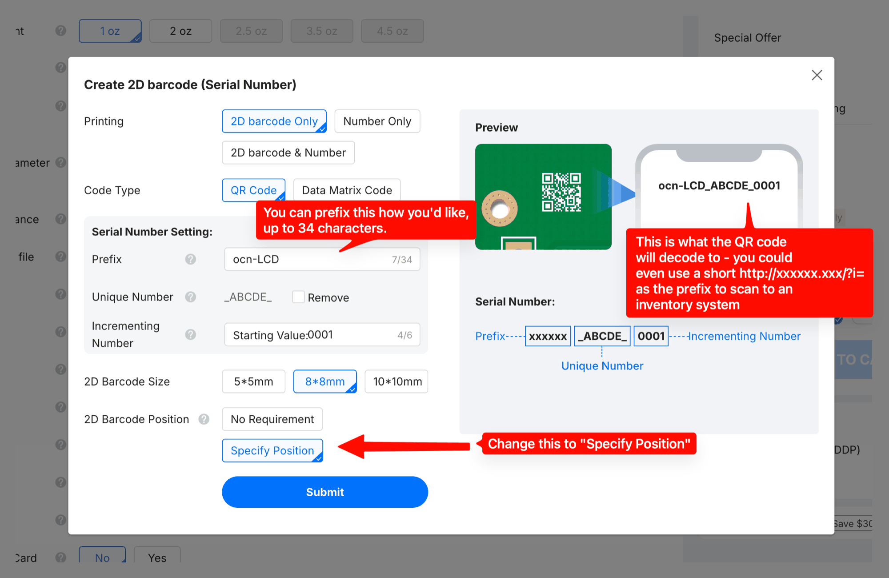
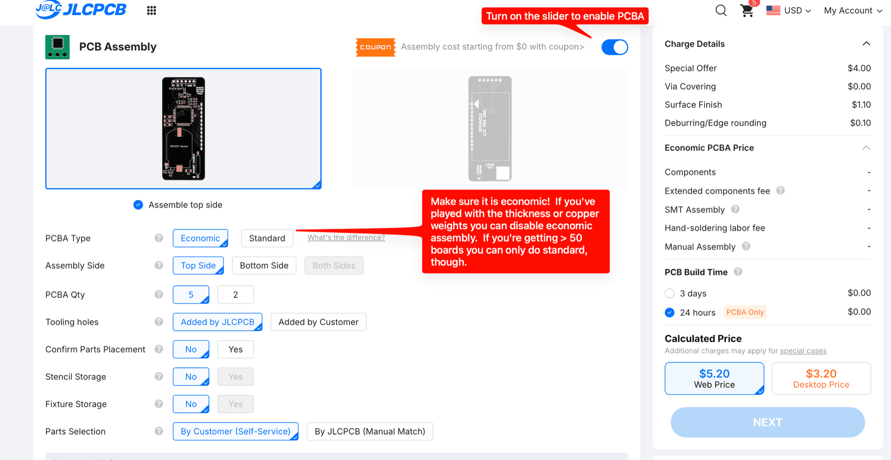
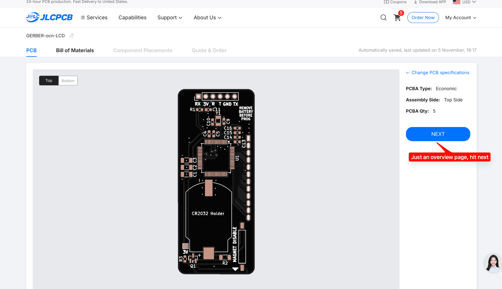
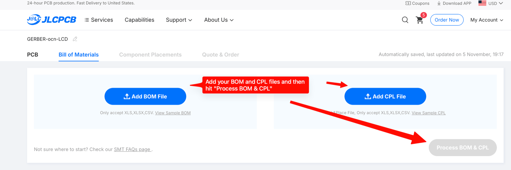
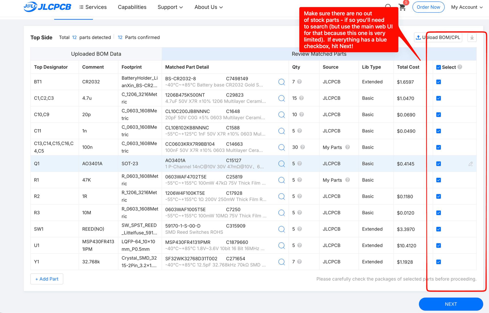
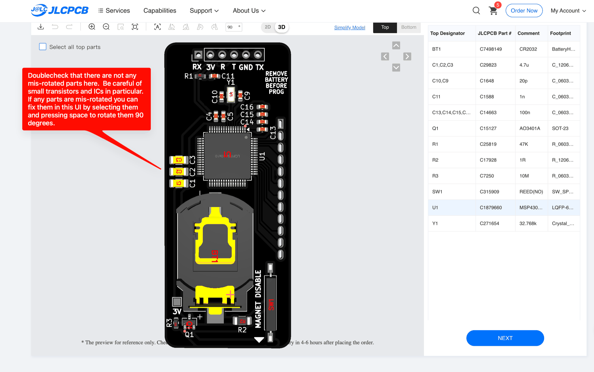
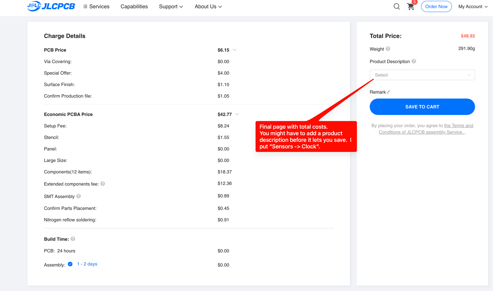

# Ordering assembled boards from JLCPCB

JLCPCB can make the board and fit every surface-mount part. You only need three files from this
repo. On GitHub, open each one and use its download button:

- [`GERBER-ocn-LCD.zip`](../GERBER-ocn-LCD.zip): the board itself
- [`BOM-ocn-LCD.csv`](../jlcpcb/production_files/BOM-ocn-LCD.csv): the parts list, with an LCSC part number for each part
- [`CPL-ocn-LCD.csv`](../jlcpcb/production_files/CPL-ocn-LCD.csv): where each part goes on the board

Five assembled boards came to about $49 in November 2026, before shipping. JLC doesn't fit the LCD,
the programming header or the battery. Those come afterwards; see [Assembly](../README.md#assembly)
in the README.

## 1. Upload the gerber zip

Start at [jlcpcb.com](https://jlcpcb.com) and add `GERBER-ocn-LCD.zip`. The size and layer count fill
in from the file.

## 2. Board options

Change the surface finish to **LeadFree HASL**. Leave everything else at its default. You can pick
another soldermask colour if you like.

## 3. Optional: a QR code serial number

The back of the board has an 8 × 8 mm silkscreen box. Choose **2D barcode (Serial Number)** under
*Mark on PCB* and JLC prints a unique QR code in that box.

In the dialog, pick **8\*8mm** and **Specify Position** so the code lands in the box. The prefix is
up to you.

## 4. Turn on assembly

Turn on the PCB Assembly switch. Choose **Economic**, **Top Side**, and the number of boards you
want assembled. If Economic isn't available, check that the board thickness and copper weight are
still at their defaults.

## 5. Overview

The next page is a summary. Click **Next**.

## 6. Upload the BOM and placement files

Add `BOM-ocn-LCD.csv` and `CPL-ocn-LCD.csv`, then click **Process BOM & CPL**.

## 7. Check the parts

All 12 lines should be matched, in stock and ticked. If a part is out of stock, find a replacement
on JLC's main parts search, which works better than the search on this page.

Two lines in the screenshot say *My Parts* because they came out of the author's own JLC stock. On
your order they will come from JLCPCB.

## 8. Check the placement

Look over the preview for parts at the wrong angle, especially the transistor (Q1) and the
microcontroller (U1). To fix one, select it and press Space to turn it 90°.

## 9. Save to cart

The last page shows the total. You may need to choose a product description before it lets you save.
"Sensors → Clock" works. Then **Save to Cart** and check out as usual.

